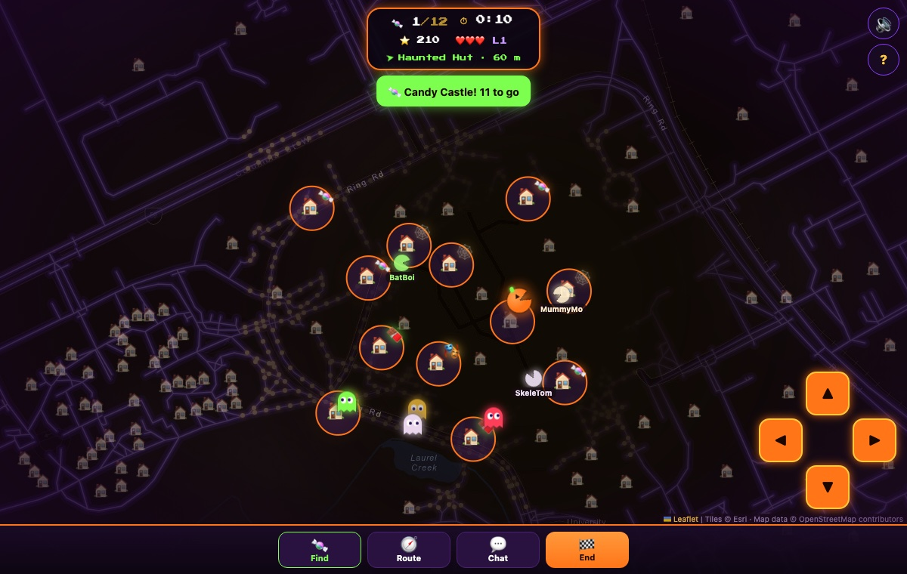

# 🎃 Pack_Ween

**Pac-Man on your real streets.** Trick-or-treat around your actual neighbourhood, collect candy from volunteer houses, dodge ghosts that hunt you through the streets, and race your neighbours up the leaderboard.

**▶ Play it live: https://a77chand.github.io/Pack_Ween1/**

**Demo login:** name `Demo`, PIN `1234` (or tap *"Just looking? Use the demo account"* on the start screen).

<sub>The page is served by GitHub Pages, so it opens instantly. The game server runs on Render's free tier at pack-ween.onrender.com and pings itself every 10 minutes to stay awake. After a fresh deploy, the first load can still take up to a minute while it wakes.</sub>



## How it works

The streets around you become a Pac-Man maze. The game downloads your neighbourhood's real street network from OpenStreetMap and turns it into a graph: in **Arcade** mode Pac-Man runs along the actual roads and footpaths, turning at real intersections. Houses handing out candy show up as 🏠🍬. Get within **25 m** of one and the server checks your position before the candy counts.

Play it two ways:

- 🕹️ **Arcade · At home:** join the fun from home with the arrow keys, WASD or the on-screen D-pad, and race other at-home players. Four ghosts chase you along the streets, each with its own Pac-Man personality, switching between scattering to their corners and hunting you. A 🍫 **full-size-bar house** is a power-up: the ghosts turn purple and run, and you can eat them.
- 🚶 **Walk · Ranked:** your real GPS. You physically walk to the houses, and the run goes on a separate ranked leaderboard that the server protects with speed checks. Nothing can really catch you outside, so here the ghosts are harmless and just drift around for atmosphere.

## Features

**Arcade (at home)**
- 🌃 **Neon maze:** the real streets are redrawn as glowing corridors over a darkened city, with fog of war around Pac-Man, flickering jack-o'-lantern houses, mist and lightning with thunder. A 🎥 **3D camera** tilts it into perspective.
- ⭐ **Score, combos, lives and levels:** Pac-dots on every street (10 points each), candy worth 100 × your combo (chain houses within 10 s, up to x5), and ghosts worth 200 → 400 → 800 → 1600. You get 3 lives, and clearing a neighbourhood banks a bonus and starts the next level with faster ghosts.
- 👻 **Ghost AI:** Banshee chases you, Ghoul cuts you off, Sheet flanks with Banshee, and Spook loses its nerve up close. At every junction each ghost takes the shortest street to its target (a Dijkstra distance field). Getting caught costs a life and +10 s.
- 🍫 **Power-up houses:** full-size bars frighten the ghosts so you can eat them (−5 s each). ⚡ energy drinks give a speed boost, 🎭 costumes hide you, and 🕸️ haunted houses send the ghosts into a frenzy.
- 🎨 **Skins** that unlock with lifetime candy, a 📅 **daily challenge** with a twist everyone shares, a see-through **replay of your best run** to race, and a 🌕 **witching hour** (double points from 9 to 10 pm).
- ⚔️ **Race-me links:** share a result and a friend races a replay of your exact run.

**Walk · Ranked (outside)**
- 📍 **Real GPS** play with a separate ranked leaderboard. Ghosts are harmless here and just drift by for atmosphere.
- 👪 **Parent safety mode:** a private live-location link a parent can follow, curfew reminders, and a route that avoids busy roads.
- 📷 **AR ghosts:** point your phone camera down the street to see the ghosts and candy houses where they really are, with a radar.
- 🟢 **Live multiplayer:** other walkers nearby appear on your map in real time. At-home Arcade players are never shown, so nobody's home is given away.

**For everyone**
- 🧭 **Route planner:** shortest street distance between every pair of houses, a nearest-neighbour start, then 2-opt. The result is drawn as Pac-dots along the streets.
- 🏠 **Volunteer houses:** pin your house where you're standing. It's ✓ verified after three different players collect there, can be reported as "no candy here", and visitors can vote it the 🏆 **spookiest house** on the street.
- 🥇 **Local leaderboards:** street (300 m), district (3 km), city (25 km) or world, each player's best run, most candy then fastest.
- 🖼️ **Result pictures** for sharing, a 🎓 **first-run tutorial**, ↩️ **resume** after a reload, 💬 **neighbourhood chat**, and 🔊 synthesised retro sound.
- 🎃 **Demo players** (display only) so there's always someone around: on the leaderboards, chatting and replying to you, running the streets as other Pac-Men, and in the "out near you" feed. They're labelled "demo" in the chat and on the leaderboard.

**Under the hood**
- 🗺️ **Streets from OpenStreetMap** are compacted into a graph: largest connected piece only, straight stretches simplified, busy roads tagged. Every candy house gets a "driveway" onto it, so every house is reachable.
- 🛡️ **Anti-cheat:** each run has a movement budget that refills at walking or running speed. Teleporting or driving earns strikes and pauses candy claims, and five strikes keep the run off the leaderboard. Race links use unguessable tokens.
- 👤 **Accounts:** a name plus a PIN hashed with scrypt, with wrong guesses rate-limited.
- 💾 **SQLite** through Node's built-in `node:sqlite`, so there's nothing extra to install.

## How to play

1. Open **https://a77chand.github.io/Pack_Ween1/** and allow location access. Without it you get the demo neighbourhood in Waterloo.
2. Sign in as **Demo / 1234**, or enter your own name and any 4-digit PIN. A new name is claimed for you, the PIN keeps it yours on the leaderboard, and returning players use the same PIN.
3. Pick **Arcade · At home** or **Walk · Ranked**, then **Start trick-or-treating**.
4. Collect every 🏠🍬. **🍬 Find** draws a green line to the nearest one and **🧭 Route** lays Pac-dots through all of them.
5. In Arcade, grab a 🍫 house to turn the tables on the ghosts.
6. Collect everything, or tap **🏁 End**, to see your stats and the leaderboard. **🖼️ Share picture** sends a result card with a race-me link.

To hand out candy, tap **🏠 Hand out candy** on the start screen while standing at your door.

If nobody near you is handing out candy yet, the game fills the area with 12 demo houses. Players in the same area get the same demo houses, so they can race each other fairly.

## Tech stack

| Part | Built with |
|---|---|
| Backend | Node.js 22.13+, Express 5, SQLite (`node:sqlite`) |
| Game | Vanilla JavaScript modules (no build step), [Leaflet](https://leafletjs.com/) |
| Street data | [OpenStreetMap](https://www.openstreetmap.org/) via the [Overpass API](https://overpass-api.de/), cached per area |
| Map tiles | Esri World Street Map, with OpenStreetMap France as a backup |
| Tests | `node:test`: API, anti-cheat, verification, privacy, route planning, street maze and ghost AI |
| Hosting | GitHub Pages for the game page (instant load) + Render free web service for the API |

## Run it locally

Needs [Node.js](https://nodejs.org/) 22.13 or newer.

```bash
cd backend
npm install
npm start        # http://localhost:4000
npm test         # 25 tests
```

| Environment variable | Default | What it does |
|---|---|---|
| `PORT` | `4000` | Port to listen on |
| `DATA_DIR` | `backend/data` | Where the SQLite database is kept |
| `OSM_DISABLED` | unset | Set to `1` to never call Overpass (only baked maps work, other places play in free-roam mode) |
| `RENDER_EXTERNAL_URL` | set by Render | When present, the server pings itself every 10 minutes so the free plan doesn't sleep |

Add `?debug` to the page URL to expose the game state for automated browser tests.

The server creates the shared **Demo** account (PIN `1234`) at startup. Several people can play on it at once without ending each other's runs.

Overpass often takes 20–40 seconds for a new area, so each map is fetched once, cached in SQLite, and the game lets you roam freely until it arrives. The default Waterloo neighbourhood ships pre-baked in `backend/osm/` so it loads instantly. To bake another area: `npm run bake-osm -- <lat> <lng> <name>`.

## API

The backend serves a JSON API (and the game page too, at pack-ween.onrender.com). GitHub Pages serves the same page from `backend/public` and calls the API on Render. Full request and response examples are in [backend/README.md](backend/README.md).

| Method | Path | What it does |
|---|---|---|
| GET | `/health` | Health check |
| POST | `/players` | Sign up or sign in with a name and PIN, returns a token |
| GET | `/players/me` | Your stats, hosted houses and any unfinished run |
| GET | `/neighbourhood?lat=&lng=` | Candy houses around a point (demo houses fill empty areas) |
| GET | `/streets?lat=&lng=` | Street graph for the maze (202 while it's still being fetched) |
| GET | `/houses?lat=&lng=&radius=` | Volunteer houses, with claims and verified status |
| POST | `/houses` | Pin your house (signed in) |
| DELETE | `/houses/:id` | Remove your house |
| POST | `/houses/:id/report` | "No candy here" (you must be within 60 m) |
| POST | `/runs/start` | Start a run (`mode`: `gps` or `arcade`) |
| GET | `/runs/:id` | Run state, used to resume |
| POST | `/runs/:id/ping` | Position update for the speed check |
| POST | `/runs/:id/visit` | Claim a house's candy |
| POST | `/runs/:id/event` | Arcade only: caught by a ghost (+10 s) or ate one during a power-up (−5 s) |
| POST | `/runs/:id/finish` | End a run |
| GET | `/leaderboard?scope=&mode=&lat=&lng=` | Best run per player near you |
| GET | `/route?lat=&lng=&runId=` | Suggested walking order through the remaining houses |
| GET / POST | `/chat` | Read and post neighbourhood chat (demo players reply) |
| GET | `/activity?lat=&lng=` | Who's playing near you and what just happened |
| GET | `/live?lat=&lng=` | Real Walk-mode players nearby and their latest positions (at-home Arcade players stay private) |
| GET | `/race/:token` | A finished Arcade run's path, for race-me links (unguessable token) |
| POST | `/runs/:id/share` | Make a private live-location link (optional `curfew`) |
| GET | `/watch/:token` | What the parent page shows: position, candy, curfew |
| POST | `/houses/:id/vote` | "Spookiest decorations" vote (only after collecting its candy) |

## Project structure

```
backend/
  server.js             Starts the server: database, street maps, app
  src/
    app.js              Express routes: accounts, runs, houses, leaderboards, chat
    anticheat.js        Speed checks: movement budget, strikes, cooldowns, flags
    neighbourhood.js    Which houses a run gets; demo houses snapped to real buildings
    osm.js              Overpass fetching, street-graph compaction, caching
    route.js            Nearest-neighbour + 2-opt route planning
    bots.js             Display-only demo players: leaderboard, chat, activity feed
    db.js               SQLite schema
  public/
    index.html, style.css
    watch.html          The parent's live-location page
    js/main.js          Game flow, HUD, claims, levels, results, chat, hosting, 3D, parent mode
    js/streets.js       Street graph, Dijkstra (with a busy-road-avoiding option), the Walker
    js/ghosts.js        Ghost AI (harmless wanderers in Walk mode)
    js/rivals.js        Demo players' Pac-Men running between the houses
    js/fx.js            Neon maze, street dots, fog of war, mist and lightning (canvas)
    js/arcade.js        Score, skins, power-up houses, daily challenge, replays
    js/ar.js            Camera AR view of ghosts and houses
    js/extras.js        First-run tutorial and the shareable result picture
    js/route.js         Street routes and Pac-dots
    js/sound.js         Web Audio sound effects
  osm/waterloo.json     Pre-baked street map for the demo neighbourhood
  scripts/bake-osm.js   Bake a street map for another area
  test/                 node:test suites
.github/workflows/
  pages.yml             Deploys backend/public to GitHub Pages
  keep-awake.yml        Scheduled ping (backup; GitHub only runs it every few hours)
front_end/              React + Vite UI prototype from the hackathon frontend team
docs/screenshot.jpg     Screenshot used in this README
```

## Done since the hackathon

The original version listed these as next steps. They're all done now:

- ~~Data resets on restart~~ → stored in **SQLite**.
- ~~Location can be faked~~ → **server-side speed checks** with strikes, claim cooldowns and flagged runs.
- ~~Demo mode is only for trying it out~~ → **Arcade** has its own leaderboard, and **Walk · Ranked** is GPS only.
- ~~No accounts, houses unverified~~ → **name + PIN accounts**, and houses are **verified by real visits** and can be **reported**.
- ~~Ghosts are just decoration~~ → in Arcade, ghosts **chase you along the streets** and can be **eaten**. In Walk mode they stay harmless on purpose.
- ~~Nobody else around~~ → **demo players** on the leaderboard, in the chat and on the map.
- ~~Leaderboard "zones" were just labels~~ → leaderboards are **geographic**: street, district, city or world.
- ~~Route went through every house in the database~~ → the route only covers **your run's houses**, **along real streets**.

## Limitations

- **The free hosting plan wipes its disk on every deploy,** so the live demo's data resets when new code ships, and the server is cold for up to a minute afterwards. Pointing `DATA_DIR` at a persistent disk fixes the data loss on any paid host.
- **A new area's street map can take up to a minute** to arrive from Overpass the first time. Until then you can roam freely, and after that it's cached.
- **Speed checks catch teleporting and driving, not a careful spoofer** who fakes a believable walking path. Ghost encounters are reported by the browser and limited by the server, but not proven.
- **Demo houses are generated,** so in areas without volunteers they sit on real buildings, but nobody there is actually handing out candy.
- **Demo players are simulated.** Their scores, chat and map movement are generated for display.
- **3D and AR are lightweight.** The 3D camera tilts the 2D map (buildings stay flat), and AR needs a phone compass. Both were tested in a headless browser, not yet on many real phones.
- **The PIN is light protection.** It stops someone else using your leaderboard name; it isn't meant to guard anything sensitive. The Demo PIN is public on purpose.

## Team

Built at ElleHacks by a team of four.

- Anusha Chandra: backend
- Homaira Hotak: backend
- Urooj Ahmed: frontend
- Sophia Pimenovsky: frontend

## Credits

Map and street data © [OpenStreetMap](https://www.openstreetmap.org/copyright) contributors (ODbL), fetched through the [Overpass API](https://overpass-api.de/). Map tiles © Esri. Map library: [Leaflet](https://leafletjs.com/). Font: [Press Start 2P](https://fonts.google.com/specimen/Press+Start+2P).
