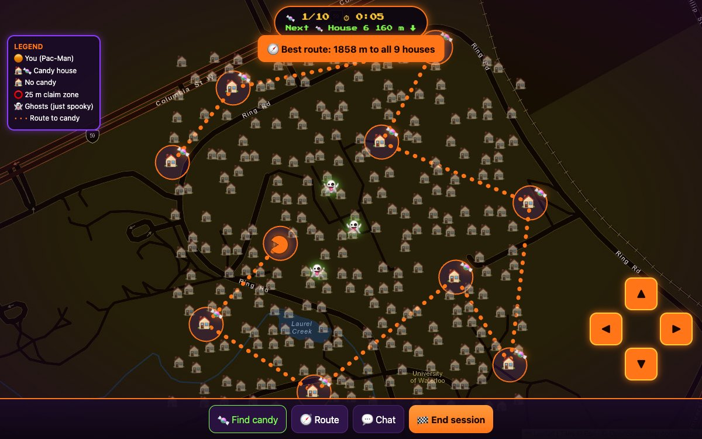

# 🎃 Pack_Ween

**Pac-Man meets trick-or-treating.** Walk your real neighbourhood, collect candy from volunteer houses, and race your neighbours up the leaderboard.

**▶ Play it live: https://pack-ween1.onrender.com**
<sub>Hosted on a free server: the first load can take 30–60 seconds while it wakes up.</sub>



## How it works

Open the site on your phone and go trick-or-treating. Houses handing out candy show up as 🏠🍬 on a real street map, and you're Pac-Man. Get within **25 m** of a candy house and the candy is claimed automatically. When you're done, end your session to see where you rank on your street, district or city, then chat with neighbours about which houses had the best treats.

## Features

- 📍 **Live GPS tracking:** Pac-Man follows you as you walk.
- 🍬 **Automatic candy claims:** the server checks your distance to the house before it counts.
- 🧭 **Route planner:** suggests a walking route through every remaining candy house, nearest first.
- 🏆 **Leaderboards** by street, district or city, ranked by most candy, then fastest time.
- 💬 **Neighbourhood chat** to share the best houses.
- 🏠 **Volunteer houses:** anyone handing out candy can add their house through the API.
- 🕹️ **Demo mode:** move with the arrow keys or on-screen arrows to try it without walking.

## How to play

1. Open **https://pack-ween1.onrender.com** and allow location access.
2. Enter your name and pick a leaderboard (street, district or city).
3. Tick **"Use my real GPS location"** to play by walking, or leave it unticked to move with the arrows.
4. Walk to the 🏠🍬 houses. **🍬 Find candy** points to the nearest one and **🧭 Route** shows the full path.
5. Tap **🏁 End session** twice to see the leaderboard, then open **💬 Chat**.

If there are no candy houses near you yet, the game places 12 demo houses around your location so you can try it anywhere.

## Tech stack

| Part | Built with |
|---|---|
| Backend | Node.js, Express 5, cors. Data is kept in memory (no database yet). |
| Game page | HTML, CSS and JavaScript, [Leaflet](https://leafletjs.com/) for the map |
| Map tiles | Esri World Street Map, with OpenStreetMap France as a backup |
| Hosting | Render (free web service) |

## Run it locally

Needs [Node.js](https://nodejs.org/) 18 or newer.

```bash
cd backend
npm install
npm start
```

Then open http://localhost:4000.

## API

The backend serves the game and a small JSON API. Full request and response examples are in [backend/README.md](backend/README.md).

| Method | Path | What it does |
|---|---|---|
| GET | `/health` | Health check |
| GET | `/houses` | List houses (optional `?lat=&lng=&radius=` for nearby only) |
| POST | `/houses` | Add a volunteer house |
| POST | `/runs/start` | Start a trick-or-treating run |
| POST | `/runs/:id/visit` | Claim a house's candy (send your `lat` and `lng`) |
| POST | `/runs/:id/finish` | End a run |
| GET | `/leaderboard?zone=` | Rankings for a street, district or city |
| GET | `/route?lat=&lng=&runId=` | Suggested route through the remaining houses |
| GET / POST | `/chat` | Read and post neighbourhood chat messages |

## Project structure

```
backend/
  server.js           Express API, also serves the game page
  public/index.html   The game: map, Pac-Man, candy, route, leaderboard, chat
  README.md           API documentation
front_end/            React + Vite UI prototype from the frontend team
docs/
  screenshot.jpg      Screenshot used in this README
```

## Limitations and next steps

- **Data resets on restart.** Runs, the leaderboard and chat live in memory. Next step: a database.
- **Location can be faked.** The server trusts the location the browser sends. Next step: anti-cheat checks, such as rejecting runs that move faster than walking speed.
- **Demo mode is for trying it out.** A real release would be GPS only.
- **No accounts yet,** so volunteer houses aren't verified.
- **Free hosting sleeps** after about 15 minutes without visitors, so the first load is slow.

## Team

Built at ElleHacks by a team of four.

- Anusha Chandra: backend
- Homaira Hotak: backend
- Urooj Ahmed: frontend
- Sofia Pimenovsky: frontend

## Credits

Map data © [OpenStreetMap](https://www.openstreetmap.org/copyright) contributors. Map tiles © Esri. Map library: [Leaflet](https://leafletjs.com/). Font: [Press Start 2P](https://fonts.google.com/specimen/Press+Start+2P).
